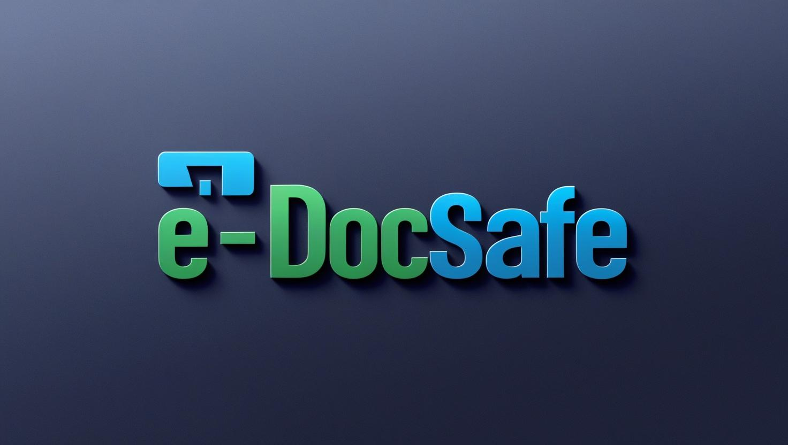

<div align="center">



# e-DocSafe
### A Secure, Offline-First Document Management Platform

[](https://web.dev/progressive-web-apps/)
[](https://firebase.google.com/)
[](https://developer.mozilla.org/en-US/docs/Web/API/IndexedDB_API)
[](LICENSE)
[]()
[]()

**"Secure. Smart. Accessible — Anytime, Anywhere."**

[Live Demo](https://your-username.github.io/e-docsafe) · [Report a Bug](mailto:support@e-docsafe.com) · [Request a Feature](mailto:support@e-docsafe.com) · [Documentation](https://www.edocsafe.com/docs)

</div>

---

## Table of Contents

- [Overview](#overview)
- [Features](#features)
- [Screenshots](#screenshots)
- [Tech Stack](#tech-stack)
- [Project Structure](#project-structure)
- [Getting Started](#getting-started)
  - [Prerequisites](#prerequisites)
  - [Local Development](#local-development)
  - [Firebase Setup](#firebase-setup)
- [Security Architecture](#security-architecture)
- [PWA Support](#pwa-support)
- [Deployment](#deployment)
  - [GitHub Pages](#github-pages)
  - [Firebase Hosting](#firebase-hosting)
- [File Reference](#file-reference)
- [Known Limitations](#known-limitations)
- [Roadmap](#roadmap)
- [Contributing](#contributing)
- [Author](#author)
- [License](#license)

---

## Overview

**e-DocSafe** is a browser-based, offline-first Progressive Web App (PWA) for secure personal and organisational document management. It is designed to work reliably in bandwidth-constrained environments — including areas with intermittent or no internet connectivity — by storing all documents locally in the browser's IndexedDB and syncing to Firebase Cloud when a connection becomes available.

The platform was built as a Diploma in Information and Communication Technology project at **Mukiria Technical Training Institute**, Kenya, and is developed and maintained by **Kelvinet Technologies**.

### Why e-DocSafe?

| Problem | e-DocSafe Solution |
|---|---|
| Cloud-only apps fail offline | IndexedDB-first — full functionality without internet |
| Privacy risks on third-party servers | Client-side AES-256 encryption before any cloud upload |
| Poor mobile experience on existing DMS tools | Responsive PWA — installable, works like a native app |
| Expensive enterprise DMS software | Free to use — built on open web standards |
| Limited offline document previewing | PDF.js, Mammoth.js, SheetJS — preview documents in-browser |

---

## Features

### 🔐 Security
- **Firebase Authentication** — secure email/password sign-in, password reset, session management
- **AES-256 client-side encryption** — files encrypted before upload; server never sees plaintext
- **TLS 1.3 in transit** — all data encrypted end-to-end during cloud sync
- **Firebase Security Rules** — per-user Firestore and Storage isolation enforced server-side
- **IndexedDB sandboxing** — local data inaccessible to other browser origins
- **Auto-lock** — configurable inactivity timeout
- **Optional two-factor authentication** (2FA)

### 📁 Document Management
- Upload documents via file picker or drag-and-drop
- Preview documents in-browser — PDF, DOCX, XLSX, PPTX, images, plain text
- Rename, delete (soft), restore from trash, and permanently purge files
- Favorite documents for quick access
- Bulk operations — clear all, restore all, delete selected
- 30-day trash retention with automatic expiry
- Sort by date (newest/oldest) and name (A→Z / Z→A)
- Filter by encrypted, favorites, or all documents

### ☁️ Offline-First Sync
- Documents saved immediately to IndexedDB — no internet required
- Automatic background sync to Firebase Firestore + Storage when online
- Conflict resolution using timestamp-based merge strategy
- Visual online/offline status indicator
- Pending sync queue — no data loss during extended offline periods

### 🔗 Sharing
- Generate secure time-limited share links with optional password protection
- Share via email directly from the platform
- Share to LinkedIn via Web Share API
- Configurable download/view-only permissions per link
- Optional link expiry date

### 📱 Progressive Web App
- Installable on Android, iOS, Windows, macOS, and Linux
- Full offline access after first load via Service Worker caching
- "Add to Home Screen" support
- App shortcuts for Upload, Documents, and Favorites
- Share target — receive files from other apps on Android

### 🎨 Interface
- Dark mode / light mode toggle (persisted in localStorage)
- Fully responsive — desktop, tablet, and mobile
- Grid and list view toggle for documents
- Real-time search with autocomplete suggestions
- Activity feed with CSV export
- Analytics dashboard — file type distribution and upload history charts
- In-app live chat support widget
- FAQ and knowledge base section

---

## Screenshots

> Screenshots to be added after deployment. Place images in `/assets/screenshots/`.

| Dashboard | My Documents | Dark Mode |
|---|---|---|
|  |  |  |

---

## Tech Stack

### Frontend
| Technology | Purpose |
|---|---|
| HTML5 / CSS3 | Structure and styling |
| Vanilla JavaScript (ES6+) | All application logic — no framework |
| CSS Grid / Flexbox | Responsive layouts |
| CSS Custom Properties | Theme tokens (dark/light mode) |
| Font Awesome 6.6 | Icons |
| Google Fonts (Inter + Poppins) | Typography |

### Storage & Sync
| Technology | Purpose |
|---|---|
| IndexedDB (via DBHelper.js) | Offline-first local document storage |
| Firebase Firestore | Cloud metadata sync and real-time updates |
| Firebase Cloud Storage | Cloud backup of document files |
| localStorage | User preferences, pending sync queue, theme |
| Service Worker Cache API | App shell caching for offline access |

### Backend Services (Firebase)
| Service | Purpose |
|---|---|
| Firebase Authentication | User sign-up, sign-in, password reset, session management |
| Cloud Firestore | NoSQL document metadata database |
| Firebase Storage | Binary file cloud storage |
| Firebase Hosting | Optional static site hosting |

### Document Rendering
| Library | Renders |
|---|---|
| PDF.js 2.6 | PDF documents |
| Mammoth.js 1.4 | DOCX / DOC files |
| SheetJS (XLSX) 0.18 | XLSX / XLS spreadsheets |
| Marked.js | Markdown files |
| Chart.js | Analytics charts |
| HTML5 `` | JPEG, PNG, WEBP, GIF, TIFF |

### Development Tools
| Tool | Purpose |
|---|---|
| Visual Studio Code | Primary editor |
| Chrome DevTools | Debugging and performance profiling |
| Firebase CLI | Deployment and rules management |
| Git + GitHub | Version control |

---

## Project Structure

```
e-docsafe/
│
├── index.html                    # Main platform (renamed from e-DocSafe-platform.html)
├── Sign-In.html                  # Login page
├── Sign-Up.html                  # Registration page
├── Landing-page.html             # Account deletion confirmation page
├── Terms.html                    # Terms of Service
├── Privacy-policy.html           # Privacy Policy
│
├── e-DocSafe-platform.css        # Main platform stylesheet (3,800+ lines)
├── styles.css                    # Auth pages stylesheet (Sign-In / Sign-Up)
│
├── e-DocSafe.js                  # Core application logic
├── auth.js                       # Sign-in / Sign-up / forgot password logic
├── DBHelper.js                   # IndexedDB abstraction layer
├── UploadModal.js                # File upload handling and validation
│
├── firebase-config.js            # Firebase initialisation and service exports
├── firebase-auth.js              # Firebase Auth manager class
├── firebase-sync.js              # Firestore + Storage sync manager
├── firebase-service-worker.js    # PWA service worker (caching + background sync)
│
├── manifest.json                 # PWA web app manifest
├── firebase.json                 # Firebase CLI configuration
├── firestore.rules               # Firestore Security Rules
├── firestore.indexes.json        # Firestore composite indexes
├── storage.rules                 # Firebase Storage Security Rules
├── .nojekyll                     # Disables Jekyll processing on GitHub Pages
│
├── e-DocSafe-favicon.ico         # Browser favicon
├── e-DocSafe-logo.png            # Platform logo
│
└── icons/                        # PWA icons (generate from logo)
    ├── icon-72x72.png
    ├── icon-96x96.png
    ├── icon-128x128.png
    ├── icon-144x144.png
    ├── icon-152x152.png
    ├── icon-192x192.png            ← maskable
    ├── icon-384x384.png
    ├── icon-512x512.png            ← maskable
    ├── shortcut-upload.png
    ├── shortcut-docs.png
    └── shortcut-favorites.png
```

---

## Getting Started

### Prerequisites

- A modern browser (Chrome 90+, Firefox 88+, Edge 90+, Safari 15+)
- A [Firebase](https://firebase.google.com/) account (free Spark plan is sufficient)
- [Node.js](https://nodejs.org/) v18+ (only needed for Firebase CLI)
- [Git](https://git-scm.com/)

### Local Development

```bash
# 1. Clone the repository
git clone https://github.com/your-username/e-docsafe.git
cd e-docsafe

# 2. Serve locally (pick one method)

# Option A — VS Code Live Server extension (recommended)
#   Right-click index.html → "Open with Live Server"

# Option B — npx serve
npx serve . -p 5500

# Option C — Python
python3 -m http.server 5500

# 3. Open in browser
# http://localhost:5500
```

> **Note:** The app requires HTTPS for the Service Worker to register. For local development, `localhost` is treated as a secure origin by all major browsers, so HTTP on localhost works fine.

### Firebase Setup

> A complete step-by-step Firebase setup guide (including Security Rules, CORS configuration, API key restrictions, and Firebase CLI deployment) is available as a downloadable document:  
> 📄 **`e-DocSafe_Firebase_Setup_Guide.docx`** — included in this repository.

**Quick summary:**

1. Create a Firebase project at [console.firebase.google.com](https://console.firebase.google.com)
2. Enable **Email/Password** Authentication
3. Create a **Firestore Database** in production mode
4. Enable **Cloud Storage**
5. Copy your Firebase config into `firebase-config.js`
6. Deploy the Security Rules:
   ```bash
   firebase deploy --only firestore:rules,storage
   ```
7. Add your deployment domain to Firebase Auth → **Authorised Domains**

---

## Security Architecture

```
┌─────────────────────────────────────────────────────────────────┐
│                        USER'S BROWSER                           │
│                                                                 │
│  ┌──────────────┐    AES-256 encrypt    ┌──────────────────┐   │
│  │  User Files  │ ──────────────────▶  │   IndexedDB      │   │
│  └──────────────┘                       │  (local store)   │   │
│                                         └────────┬─────────┘   │
│                                                  │ Online?      │
└──────────────────────────────────────────────────┼─────────────┘
                                                   │ TLS 1.3
                                                   ▼
                                    ┌──────────────────────────┐
                                    │      FIREBASE CLOUD      │
                                    │                          │
                                    │  ┌────────────────────┐  │
                                    │  │  Firebase Auth     │  │
                                    │  │  (session tokens)  │  │
                                    │  └────────────────────┘  │
                                    │                          │
                                    │  ┌────────────────────┐  │
                                    │  │  Firestore         │  │
                                    │  │  (metadata)        │  │
                                    │  │  Security Rules ✓  │  │
                                    │  └────────────────────┘  │
                                    │                          │
                                    │  ┌────────────────────┐  │
                                    │  │  Cloud Storage     │  │
                                    │  │  (encrypted files) │  │
                                    │  │  Security Rules ✓  │  │
                                    │  └────────────────────┘  │
                                    └──────────────────────────┘
```

### Security Measures Summary

| Layer | Mechanism |
|---|---|
| Authentication | Firebase Auth — email/password, session tokens, auto-expiry |
| Local isolation | IndexedDB sandboxed per browser origin |
| Encryption at rest | AES-256 client-side before IndexedDB write and cloud upload |
| Encryption in transit | TLS 1.3 for all Firebase communication |
| Cloud access control | Firestore + Storage Security Rules (per-user UID enforcement) |
| API key protection | HTTP referrer restrictions + API-specific restrictions in GCP |
| File type control | Storage Rules MIME type whitelist (no executables or archives) |
| File size control | 50 MB per-file limit enforced in UploadModal.js and Storage Rules |

---

## PWA Support

e-DocSafe is a fully compliant Progressive Web App:

| Feature | Status |
|---|---|
| Installable (Add to Home Screen) | ✅ |
| Offline access | ✅ Service Worker caches app shell |
| Background sync | ✅ Queues uploads when offline, syncs on reconnect |
| App shortcuts | ✅ Upload, Documents, Favorites |
| Share target | ✅ Receive files from other Android apps |
| Responsive design | ✅ Mobile, tablet, desktop |
| Splash screen | ✅ Themed to brand colours |
| maskable icons | ✅ 192px and 512px |

### Generating PWA Icons

Use [maskable.app/editor](https://maskable.app/editor) to generate all required icon sizes from `e-DocSafe-logo.png`. Export to the `/icons/` directory.

---

## Deployment

### GitHub Pages

```bash
# 1. Rename the platform file
mv e-DocSafe-platform.html index.html

# 2. Update all internal redirects in auth.js and e-DocSafe.js
#    Change: window.location.href = 'e-DocSafe-platform.html'
#    To:     window.location.href = 'index.html'

# 3. Push to GitHub
git init
git add .
git commit -m "Initial e-DocSafe deployment"
git branch -M main
git remote add origin https://github.com/your-username/e-docsafe.git
git push -u origin main

# 4. Enable GitHub Pages
#    Repo → Settings → Pages → Source: Deploy from branch → main → / (root)
```

Your site will be live at: `https://your-username.github.io/e-docsafe/`

> ⚠️ **Important:** After deploying, add `https://your-username.github.io` to Firebase Auth → Sign-in method → Authorised domains. Without this, login will fail with an `auth/unauthorized-domain` error.

### Firebase Hosting

```bash
# Install Firebase CLI
npm install -g firebase-tools

# Login and initialise
firebase login
firebase init

# Deploy
firebase deploy

# Deploy site only (not rules)
firebase deploy --only hosting

# Preview before going live
firebase hosting:channel:deploy preview --expires 2d
```

Live at: `https://e-docsafe.web.app` and `https://e-docsafe.firebaseapp.com`

---

## File Reference

| File | Description |
|---|---|
| `index.html` | Main platform — dashboard, documents, upload, settings, trash, help |
| `Sign-In.html` | Login page with remember-me and in-page forgot password modal |
| `Sign-Up.html` | Registration page with terms agreement checkbox |
| `Landing-page.html` | Post-account-deletion page with 30-day countdown recovery timer |
| `Terms.html` | Full Terms of Service (14 sections, Kenyan jurisdiction) |
| `Privacy-policy.html` | Full Privacy Policy (12 sections, Data Protection Act 2019) |
| `e-DocSafe-platform.css` | Platform stylesheet — layout, components, dark mode, responsive |
| `styles.css` | Auth page stylesheet — glassmorphism card design |
| `e-DocSafe.js` | Core logic — document CRUD, UI, charts, search, activity feed |
| `auth.js` | Firebase sign-in/up, password reset, auth state guard |
| `DBHelper.js` | IndexedDB layer — openDB, getAllDocs, addDocWithSync, trash, restore |
| `UploadModal.js` | Upload modal — file validation, FileReader, progress, multi-file |
| `firebase-config.js` | Firebase app init and global service exports |
| `firebase-auth.js` | `SimpleAuthManager` class wrapping Firebase Auth methods |
| `firebase-sync.js` | `FirebaseSyncManager` — Firestore real-time listener, sync queue |
| `firebase-service-worker.js` | Service Worker — network-first caching, background sync |
| `manifest.json` | PWA manifest — name, icons, shortcuts, share target, theme colour |
| `firebase.json` | Firebase CLI config — hosting, rules paths, cache headers |
| `firestore.rules` | Firestore Security Rules — per-user read/write enforcement |
| `firestore.indexes.json` | Composite indexes for sort/filter queries |
| `storage.rules` | Storage Security Rules — MIME whitelist, 50 MB limit, per-user paths |
| `.nojekyll` | Prevents GitHub Pages Jekyll processing |

---

## Known Limitations

| Limitation | Detail |
|---|---|
| IndexedDB storage quota | Browser-dependent — typically 60–80% of available disk space; Chrome enforces eviction under storage pressure |
| No real-time collaboration | Multi-user concurrent editing is not supported in v1.x |
| No server-side OCR | Document text search is filename-only; content search requires OCR integration (planned) |
| Browser compatibility | Requires IndexedDB, Service Workers, and ES6+ — IE11 and older browsers are not supported |
| Share link hosting | Generated share links require the recipient to be online to access the file from Firebase Storage |
| File format previews | Password-protected PDFs and DOCX files with complex macros may not preview correctly |
| iOS PWA limitations | Background sync and push notifications have reduced functionality on iOS due to Safari's WebKit restrictions |

---

## Roadmap

### v1.3 (Next)
- [ ] End-to-end encryption key management UI
- [ ] OCR integration for in-document text search
- [ ] Bulk download as ZIP
- [ ] Document expiry and reminder notifications

### v2.0
- [ ] Multi-user access control with role-based permissions (viewer / editor / admin)
- [ ] Real-time collaborative annotations
- [ ] AI-powered document categorisation
- [ ] Multi-cloud backup (Google Drive + AWS S3)
- [ ] Native mobile apps (Flutter — Android + iOS)

### Future Considerations
- [ ] Government and academic portal integration for document verification
- [ ] Digital signature support
- [ ] LDAP / Active Directory integration for enterprise deployments
- [ ] Multi-language support (Swahili priority)

---

## Contributing

Contributions are welcome. Please follow these steps:

```bash
# 1. Fork the repository
# 2. Create a feature branch
git checkout -b feature/your-feature-name

# 3. Make your changes, following the existing code style:
#    - Vanilla JS (no frameworks)
#    - Async/await over raw Promises
#    - addDocWithSync() for all IndexedDB writes (not bare db.transaction())
#    - showNotification() for all user-facing feedback (not alert())
#    - All modals must have role="dialog", aria-modal, and aria-labelledby

# 4. Test in Chrome, Firefox, and Edge (minimum)
# 5. Commit with a clear message
git commit -m "feat: add feature description"

# 6. Push and open a Pull Request
git push origin feature/your-feature-name
```

### Code Style Guidelines

- Indent: 2 spaces
- Strings: single quotes
- Always use `'use strict';` at the top of JS files
- DOM references: resolve at `DOMContentLoaded`, never at parse time
- IndexedDB: always `await openDB()` — never use the bare `db` variable directly
- Error handling: every `async` function must have a `try/catch`
- Notifications: use `showNotification('success'|'error'|'info', message)` — never `alert()`
- Modals: never use `prompt()` or `confirm()` — use the existing `#confirmationModal`

---

## Author

**Kelvin Mwichwiri Gitonga**  
Diploma in Information and Communication Technology  
Mukiria Technical Training Institute, Kenya

**Developer & Maintainer:** Kelvinet Technologies  
📧 [support@e-docsafe.com](mailto:support@e-docsafe.com)  
🌐 [www.edocsafe.com](https://www.edocsafe.com)  
📍 Kelvinet Towers, Kelvinet Avenue, Konza City, Kenya

---

## License

This project is licensed under the **MIT License**.

```
MIT License

Copyright (c) 2025 Kelvinet Technologies

Permission is hereby granted, free of charge, to any person obtaining a copy
of this software and associated documentation files (the "Software"), to deal
in the Software without restriction, including without limitation the rights
to use, copy, modify, merge, publish, distribute, sublicense, and/or sell
copies of the Software, and to permit persons to whom the Software is
furnished to do so, subject to the following conditions:

The above copyright notice and this permission notice shall be included in all
copies or substantial portions of the Software.

THE SOFTWARE IS PROVIDED "AS IS", WITHOUT WARRANTY OF ANY KIND, EXPRESS OR
IMPLIED, INCLUDING BUT NOT LIMITED TO THE WARRANTIES OF MERCHANTABILITY,
FITNESS FOR A PARTICULAR PURPOSE AND NONINFRINGEMENT. IN NO EVENT SHALL THE
AUTHORS OR COPYRIGHT HOLDERS BE LIABLE FOR ANY CLAIM, DAMAGES OR OTHER
LIABILITY, WHETHER IN AN ACTION OF CONTRACT, TORT OR OTHERWISE, ARISING FROM,
OUT OF OR IN CONNECTION WITH THE SOFTWARE OR THE USE OR OTHER DEALINGS IN THE
SOFTWARE.
```

---

<div align="center">

Built with ❤️ in Kenya &nbsp;·&nbsp; Powered by Purpose


&copy; 2025 Kelvinet Technologies &nbsp;·&nbsp; [Privacy Policy](Privacy-policy.html) &nbsp;·&nbsp; [Terms of Service](Terms.html)

</div>
